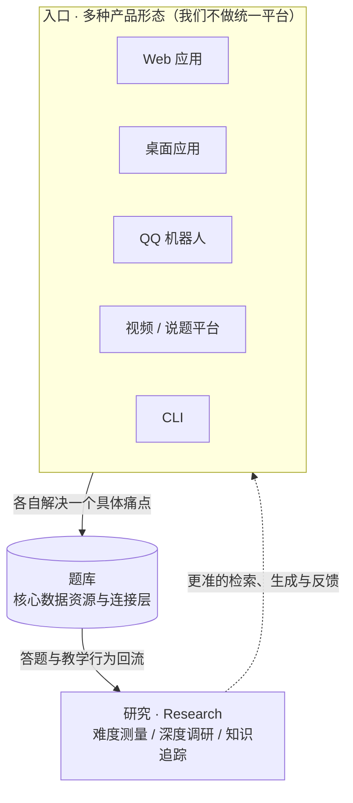

# Ciryanna · AI 智教矩阵

**西瑞安娜** — AI Education Matrix

面向中学教育的 AI 产品矩阵与研究集合 · A matrix of AI products and research for secondary education

Initiated by [@elwina](https://github.com/elwina) · 由一人发起，伙伴陆续加入

---

这不是一份产品清单，而是一套正在成形的基础设施：一个作为共同地基的题库，多个互不统一的入口，以及一层关于「题目如何反映人」的研究。多数项目仍在开发中，尚未发布。

This is not a catalog of finished products. It is infrastructure taking shape: one question bank as the common ground, several deliberately non-uniform entry points, and a research layer around a single question — how exam questions reflect the person answering them. Most projects are still under development and unreleased.

---

## 一张图 · The Shape

---

## 为什么叫「矩阵」 · Why a Matrix

**一，我们不打统一大平台。** 教师的学科、教龄、设备、备课习惯差别极大，任何一种固定产品形态都只会服务到其中一部分人。所以我们开放产品形态：网页、桌面端、即时通讯里的机器人、视频平台、命令行——哪个切面能把 AI 递到他手边，就从那个切面进去。老教师、中年教师、新教师，各自的入口不一样。

**二，我们对着痛点铺产品。** 找一类题、讲一道难题、把整张卷子变成结构化数据、在手机上做实验——每个产品只解决一件具体的事，不要求教师迁移工作流。

**三，产品是散的，数据不是。** 所有下游应用都把数据连回同一个题库。题库里存的不只题目本体，还有它的属性、解析、答案、微课、视频、知识流、研究标注——但根都是一道「题」。题目是可无限细分、可跨学科复用、可长期观察的最小单元，因此每一个真实使用场景都在给同一个底座加数据，滚雪球式地长起来。

> **We are not building one platform.** Teachers differ too much in subject, tenure, devices and habits for any single product form to fit them all — so we keep the product form open (web, desktop, chat bot, video, CLI) and let each entry point serve the teacher who is already there.
>
> **Each product targets one concrete pain**, and asks the teacher to migrate nothing.
>
> **The products are separate; the data is not.** Every downstream app connects back to one question bank, whose fundamental unit is the *question* — carrying attributes, solutions, micro-lessons, videos, knowledge flows and research labels. A question is small, composable and longitudinally observable, so every real usage compounds on the same foundation.

---

## 应用层 · Applications

**题库 · Question Bank**（核心，开发中）
整个矩阵的数据地基：题目及其属性、检索、入库、科研分析，对上提供 API、Web 与可发布的云端 CLI。默认物理工作区，可切换地理。
*The data foundation of the matrix — questions with their attributes, retrieval, ingestion and research analysis, exposed through an API, a web app and a publishable cloud CLI. Physics workspace by default, geography supported.*

**Hiranna**（开发中）
面向师生两端的搜题入口：文本与拍照搜题之上，加了给教师用的深度调研——描述一类需求，检索代理自主多轮查库、筛选并给出带匹配理由的题目列表；在此基础上再生成新题是它的下一步。
*A search entry for teachers and students. On top of text and camera lookup sits a deep-research mode for teachers: state a need in natural language, let a retrieval agent query the bank over several rounds and return matched questions with reasons; generating new questions from those results is the next step.*

**KFlow · 知识流**（开发中）
把一道复杂题目按答案解构成一条可推理的知识流，而不是几个标签。目前只做物理与地理两科。
*Decomposes one complex problem into an inferable knowledge flow derived from its solution, not a bag of tags. Physics and geography only.*

**QA Video · 说题视频**（开发中，个人仓库）
不是微课，是「说题」：一道题被完整讲一遍。在此之上探索视频里的互动——中途提问、侧栏随堂测、观看过程的可核查性。
*Not micro-lessons: full solutions spoken through. On top of it we explore interactivity inside the video — mid-play prompts, side-panel quizzes, and verifiable watching.*

**Accounts · 统一身份认证**（开发中）
矩阵自己的中央身份服务，为所有应用提供同一个稳定账户与登录边界。这是最纯粹的工程问题，也是最不能出错的一层。
*The matrix's own central identity provider, giving every application one stable account and one login boundary. The most pure engineering problem, and the layer where mistakes are least affordable.*

**Capto**（已开源 · 唯一已发布的产品）
Windows 录屏软件，Tauri 2 + Rust + React，MIT 协议。正在为它加入题目识别能力——它是我们试探桌面端与视觉识别边界的那只手。
→ [Ciryanna/Capto](https://github.com/Ciryanna/Capto) · [Ciryanna/capto-ffmpeg](https://github.com/Ciryanna/capto-ffmpeg)（带 CI 审计与证明发布的最小化 FFmpeg 构建）
*An open-source Windows screen recorder (Tauri 2 + Rust + React, MIT). Question recognition is being added — it is our probe for the desktop and the vision boundary.*

**qqbot-adapter**（已开源，个人仓库）
Go 单二进制，替业务后端承担与 QQ 官方机器人平台的全部通信：长连接、token 生命周期、可断线重放的事件流。
→ [elwina/qqbot-adapter](https://github.com/elwina/qqbot-adapter)
*A single Go binary that owns all communication with QQ's bot platform for the backend: gateway connection, token lifecycle, and a replayable durable event stream.*

> 除 Capto 与上述两个公开仓库外，其余仓库暂为私有；需要查看代码请联系我。
> Repos other than the public ones above are private for now — contact me if you want to look at the code.

---

## 研究层 · Research

**Xuan 1.0 · 难度研究**
题目难度从哪来。这是一项尚未发表的研究，这里不展开方法与结论。
*Where question difficulty comes from. Unpublished — methods and findings are intentionally not disclosed here.*

**深研 · Deep Search**
按教师的真实研究需求（例如论文选题）在题库中定位题目，并对题目与研究价值之间的关系做评分。
*Locating questions in the bank against teachers' own research needs — paper topics included — and scoring what a question is worth to a study.*

**衡 · Heng（名称待定）**
对整个题库按量表维度批量打分与标定：难度、区分度、考查方式……把「一眼觉得难」变成可复现的测量。
*(Working name.)* Batch scoring and calibration of the whole bank against scale dimensions — difficulty, discrimination, demand — turning "this looks hard" into a reproducible measurement.

**镜 · Jing（名称待定，最核心的工程）**
持续追踪学生的知识数据：显性能力（知识点掌握、细心、专注度）容易被语言描述；真正难也更值钱的是隐性能力——两道题都错，但没人说得清它们共享的那个因素是什么。
*(Working name.)* Longitudinal student knowledge tracing. Explicit abilities — mastery, carefulness, attention — already have words. Latent ones do not: a student misses both questions, and no one can yet name the factor they share.

---

## 我们真正想做的 · The Actual Goal

帮学生提分，是表层；帮老师省下时间，是中层。往下还有一层：**题目是人的探针。**

人在学生时期的行为相对纯净——做了什么题、怎么做的、在哪一步断掉，几乎一一对应到结果。于是错误里藏着信息：思维惯性从哪来，反复出错的位置为什么固定，不同表现之间有没有尚未被命名、被语言描述过的联系。我们希望通过知识追踪与测量研究，把教育数据第一次变成可用于理解「人是如何学习和思考」的严肃材料——在尊重个体、谨慎处理未成年人数据、可退出可审计的前提下。

Raising scores is the surface layer; giving teachers their time back is the middle one. Below them sits what we are actually after: **questions are probes into people.**

Student-era behaviour is comparatively clean — what you solved, how, and where the chain broke maps almost one-to-one onto the result. So mistakes carry information: where a thinking habit comes from, why the same break point keeps recurring, whether two unrelated-looking failures share a factor nobody has named yet. If done carefully, that turns education data into material serious enough to study how people learn and think — with respect for individuals, conservative handling of minors' data, and opt-out plus auditability.

---

## 工程栈 · Stack

跨仓库的实际技术选型，供同行参考：

- **桌面** Rust · Tauri 2 · React · FFmpeg 静态构建与发布证明
- **后端** Go（OIDC 身份服务、消息网关，单二进制交付）· TypeScript/Node API · MySQL · Cloudflare Workers / D1 / R2
- **前端** React 18/19 · Vite · TanStack Query · Tailwind · Next.js · KaTeX
- **AI 侧** 多模态识别、工具调用式检索代理、流式（SSE）过程展示、配额与计费记账
- **工程** monorepo、CI 门禁、可复现构建、中英双语界面

*Desktop: Rust, Tauri 2, React, audited FFmpeg static builds. Backend: Go (OIDC IdP and a durable message gateway, shipped as one binary), TypeScript/Node APIs, MySQL, Cloudflare Workers/D1/R2. Frontend: React 18/19, Vite, TanStack Query, Tailwind, Next.js, KaTeX. AI side: multimodal recognition, tool-calling retrieval agents, streamed (SSE) progress, quota accounting.*

---

## 联系 · Contact

矩阵由我一个人发起并写下大部分代码，配套应用正逐步有伙伴加入。产品尚未公开发布，研究多数未有可引用的结论——

**想进一步了解，直接联系我。** [github.com/elwina](https://github.com/elwina)

Initiated and mostly written by one person, with collaborators joining as the matrix spreads. Products are not publicly released yet, and most research has no citable result to point at — so:

**If you want to know more, just reach out.** [github.com/elwina](https://github.com/elwina)
